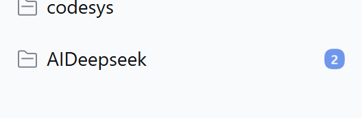
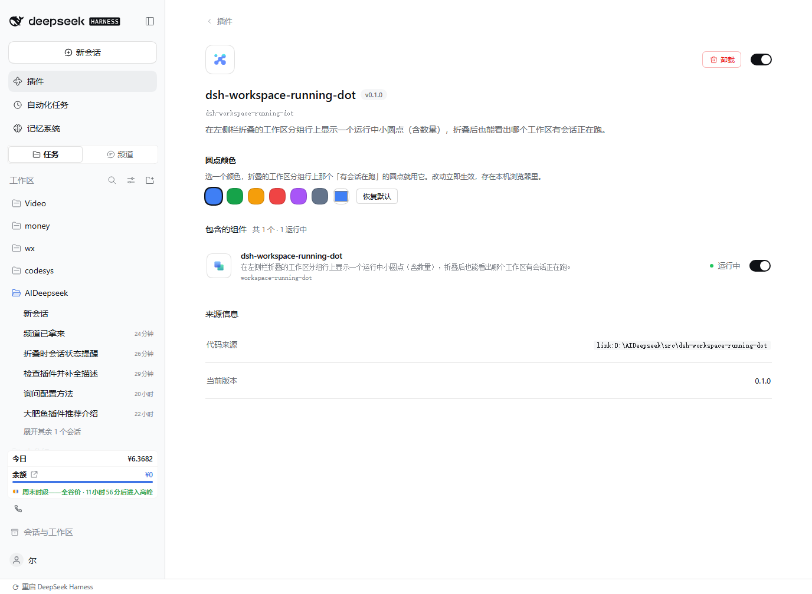

# dsh-workspace-running-dot

在左侧栏**折叠的工作区分组行**上显示一个运行中小圆点 —— 折叠起来以后也能一眼看出哪个工作区里还有会话在跑。



## 为什么需要它

侧栏「按工作区」分组时，工作区那一行折叠后就完全看不到里面的状态了。官方的运行中标记（`进行中`）只画在展开后的**会话行**上，而 `deriveGroups()` 在折叠时把 `sessions` 直接派生成 `[]`，连节点都不生成。想确认哪个工作区还在跑，只能一层层展开。

## 它做了什么

只做一件事：读 `ctx.sessions.list` 与 `ctx.workspaces.list` 两个快照，算出每个工作区里正在运行的会话数，把结果画在该工作区分组行的标题右侧。

- 圆点里始终显示数字（1 就写「1」，3 就写「3」）—— 单跑一个时也一眼看出有几个
- 没有在跑 → 没有圆点
- 数字随会话结束实时减少，归零后圆点消失，不留残骸


子代理也算：主会话的轮次结束后子代理可能还在跑，这时官方侧栏靠 `runningChildCount` 单独补状态，本插件对齐了同一语义（读 `projectionsBySession[id].values.subagentCatalog`）。

反过来，子代理**不会**被单独数一次。子代理本身也是一条会话记录，会出现在 `list.ids` 里，但侧栏从不给它单独的行；不排掉的话，一个带子代理的会话会让圆点凭空多 1。判据必须走 `subagentCatalog` —— 实测真实快照的 summary 里**没有** `parentSessionId` 字段（键只有 `id / displayTitle / running / retainedBy / blank / updatedAt / formatStatus / projectionValues / title / cwd`），拿它判会永远判不出来。

不属于任何工作区的会话单独归到「未分组」那一桶：官方把它们的 key 定成空串（`buildGroup("", …)`），行的 `data-row-key` 就是 `workspace:`。不统计这一桶的话，一个还没落进工作区的新会话跑起来时侧栏毫无动静。

## 「按工作区树」时父行也亮

树模式（`groupBy === 'workspace-tree'`）下官方把子工作区**折叠进父工作区行里**，父行往往只是个目录容器 —— 比如 `D:\AIdeepseek` 本身不生会话，会话都在 `D:\AIdeepseek\project\股票` 里。按「直属会话数」算的话父行永远是 0，最外层工作区于是一直没有圆点。

做法是沿目录前缀建「子工作区 → 父工作区」映射（抄官方 `owningParentFolder`：`child.startsWith(root + '/')` 取最长，大小写敏感），再把每个子工作区的计数累加进它所有的祖先。上面那个例子里，`股票` 有 1 个在跑，`D:\AIdeepseek` 与 `D:\AIdeepseek\project` 都会显示 1。

- 只在树模式下汇总。平铺模式（`workspace`）父子行之间没有视觉从属关系，累加会让父行凭空多出不属于它的数字。
- 父行的提示语是「N 个会话正在进行（含子工作区）」，跟单工作区的「N 个会话正在进行」区分开，免得按数字去找却找不到那么多会话。
- 成环防护：累加时用 `seen` 记录走过的节点，万一目录前缀凑出环也不会死循环。

模式从哪读：视图 store 是 `@deepseek-ai/dsh-client-ui-workspace` 的内部实例，`ctx.get('uiWorkspace')` 只交出 actions、没有读口，所以读它落在 `localStorage` 的 `dsh.workspace.view.v5` 键（`defineStore` 的 `persist`，值是 `JSON.stringify(state)`，`groupBy` 在顶层）。读不到时按 DOM 兜底：树模式必然产生 `div[role="group"]` 包住分组行，平铺模式不会。

判断放在**绘制时**而不是重算时：切「按工作区 / 按工作区树」只改视图 store，`sessions` 与 `workspaces` 两个 store 一声不响，订阅不到；但官方重渲染侧栏会动 DOM，`MutationObserver` 必然把插件叫醒。

## 改圆点颜色

打开「插件 → dsh-workspace-running-dot」，页面里有一块**圆点颜色**：6 个预设色 + 一个自定义取色器 + 「恢复默认」。



- 改动立刻生效，不用重启。
- 选中的颜色存在本机浏览器 `localStorage` 的 `dsrwd.color` 键里，只影响这个浏览器。
- 实现方式是把颜色写成根元素上的 CSS 变量 `--dsrwd-dot-color`，圆点样式读 `var(--dsrwd-dot-color, var(--dsw-alias-state-business-primary, #3f7ff5))`。用变量而不是 inline style，是因为圆点会被 `MutationObserver` 反复重画，写 inline style 每次都得重算。
- 未设置时跟随官方主题色 `--dsw-alias-state-business-primary`，主题切换会跟着变；一旦你手选过颜色，就以你的选择为准。
- 设置页是**附加功能**：注册它时整段用 `try/catch` 兜住。万一官方改了这个插槽的契约，坏的只是设置页，圆点本身照常工作。

## 为什么是 DOM 注入

查过 `@deepseek-ai/dsh-client-ui-workspace/lib/client.js`：`sidebar.workspaces` 的 children 只声明了 5 个口子（`directoryFlow` / `session.menu.item` / `session.row.action` / `session.row.leading` / `session.row.hover`），**工作区分组行 `ProjectRowItem` 本身没有任何 slot**。官方也没打算在那儿显示状态。「折叠后仍然可见的运行指示」在正规插槽层面无解，只能补 DOM。

代价：官方一旦改动分组行的结构，选择器就要跟着改。因此所有选择器都尽量靠 `data-row-key` / `aria-*` 而不是 CSS Modules 生成的 hash 类名（`hIlkoa_` 前缀每次构建都可能变）。

## 实现要点

| 关注点 | 做法 |
| --- | --- |
| 锚点 | `[data-row-key^="workspace:"]`，`row-key` 后半段就是 workspaceId |
| 插入位置 | `projectText` 之后、`rowActions` 之前 —— `rowActions` 是 `display:none`，只在 hover 时出现，放它后面圆点会随 hover 左右跳 |
| 树模式汇总 | 按目录前缀建子→父映射，把子工作区计数累加进所有祖先；只在 `workspace-tree` 下生效 |
| 模式来源 | `localStorage['dsh.workspace.view.v5']` 的 `groupBy`，读不到时按 `div[role="group"]` 是否包着分组行兜底 |
| 观察 | `MutationObserver` 挂在 `body`（`subtree: true`），折叠/展开/换视图都能触发重扫 |
| 防自激 | 扫描前 `disconnect`、扫描后重新 `observe`；只有真的改过节点才补排一帧 |
| 重绘节流 | `requestAnimationFrame`，一帧最多扫一遍 |
| 数据订阅 | `sessions.list.subscribe` + `workspaces.list.subscribe`，两者只在真变化时通知，不需要额外节流 |
| 颜色 | 根元素 CSS 变量 `--dsrwd-dot-color`，圆点样式读它；颜色偏好存 `localStorage['dsrwd.color']` |
| 设置页 | 注册到官方 `plugins.bundle.config` 插槽（key 必须是包名），组件只做取色与写值 |
| 卸载 | 所有副作用挂在 `ctx.effect` 上：样式标签、观察器、订阅、已画的圆点、颜色变量全部回收 |

## 安装

克隆到本地任意位置，然后把它 link 进 profile：

```bash
git clone https://github.com/VisualStudioXu/dsh-workspace-running-dot.git
```

```bash
# 1. 装进 profile
cd ~/.dsh/profiles/desktop
#    package.json 的 dependencies 加：
#    "dsh-workspace-running-dot": "link:<克隆下来的绝对路径>"
#    并把它加进 dsh.profile.bundles 数组

# 2. 建链接（Windows 用 junction，bash 的 ln -s 在这里会退化成复制）
cd ~/.dsh/profiles/desktop/node_modules
cmd //c "mklink /J dsh-workspace-running-dot <克隆下来的绝对路径>"

# 3. 重启 DeepSeek Harness
```

## 验证

```bash
node scripts/20261025-test-dot.mjs
```

用最小 DOM 桩跑 17 条断言：单/多会话计数、空闲无圆点、插入位置、折叠态仍可见、归零后无残留、空数据不抛错、卸载清理干净，以及颜色的默认值/归一化/非法值回落/持久化读写。

```
PASS  ws-a 单会话：圆点显示 1
PASS  ws-b 三会话：圆点显示 3
PASS  ws-c 空闲：无圆点
PASS  未分组桶：只数散落会话，子代理不算（显示 1）
PASS  圆点插在 rowActions 之前
PASS  折叠状态（aria-expanded=false）下仍然有圆点
PASS  title 可读
PASS  归零后 ws-a 无残留
PASS  空数据不抛错、无圆点
PASS  默认色写入 --dsrwd-dot-color
PASS  读到已存颜色
PASS  三位 hex 归一化成六位
PASS  非法值回落默认色
PASS  大写 hex 归一化成小写
PASS  没有存过时用默认色
PASS  卸载后样式与圆点都被清掉
PASS  卸载后颜色变量也被清掉
ALL PASS
```

## 已知限制

- 依赖官方 DOM 结构，DSH 大版本升级后可能需要调整 `dotAnchor()` 与 `ROW_SELECTOR`。
- 只在「按工作区」和「按工作区树」两种分组下有意义；「单列表」视图没有分组行，插件不画任何东西（也不需要）。
- 圆点不可点击 —— 它是指示器，不是入口。要打开那个工作区仍然点分组行本身。

## License

MIT
